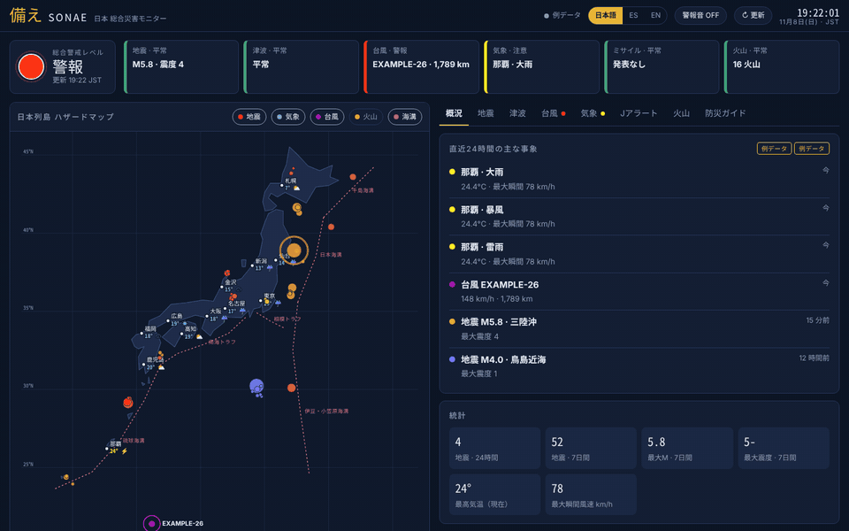
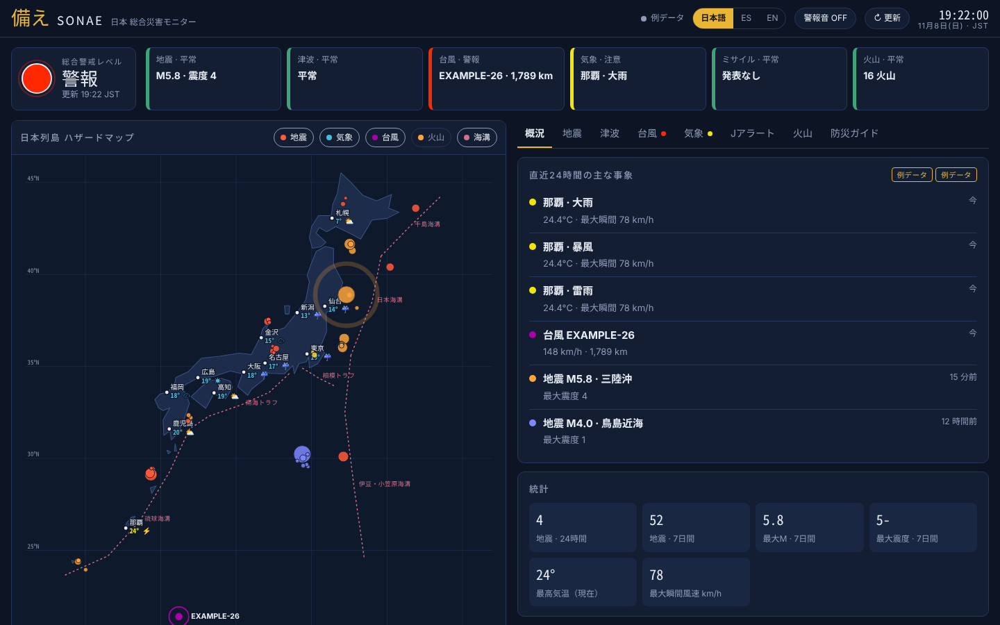
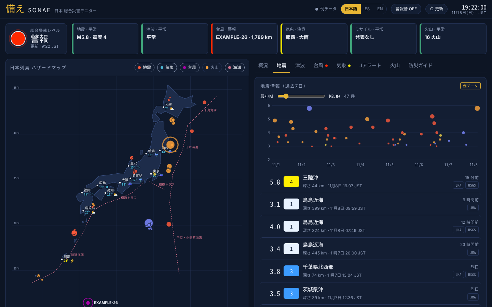
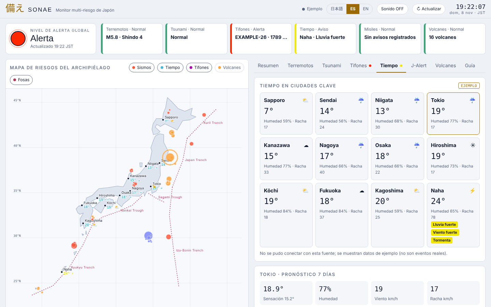
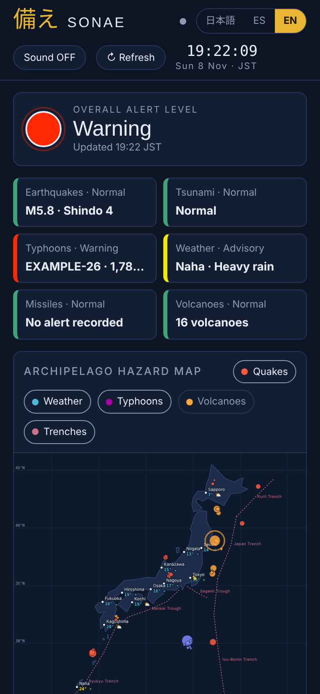
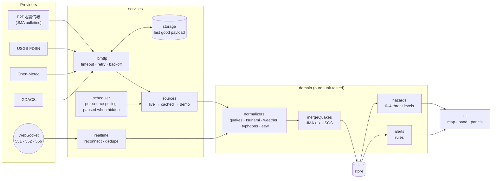

<div align="center">


# Sonae 備え

**Real-time multi-hazard monitor for Japan**
Earthquakes · Earthquake Early Warning · Tsunami · Typhoons · Weather · J-Alert · Volcanoes

日本語 · Español · English &nbsp;|&nbsp; PWA · works offline · no build step · 42 unit tests


</div>

> **日本語サマリー** — 「備え」は、地震（気象庁の震度＋USGS のマグニチュードを照合）、緊急地震速報（WebSocket でプッシュ受信）、津波、台風、気象警戒、J アラート、火山を **1 画面** にまとめた防災ダッシュボードです。通信が途切れても最後に取得したデータを鮮度付きで表示し、オフラインでも起動します。日本語・スペイン語・英語に対応。



---

## The problem

Hazard information in Japan is excellent but **fragmented**: earthquakes and tsunami on the JMA site, early warnings on TV and phones, typhoon tracks on another page, heat and rain warnings in weather apps, J-Alert only as a siren or a push message. During an event you jump between sources, most of them only in Japanese, and you rarely know how fresh what you are reading is.

Sonae answers one question at a glance: **"Is anything threatening Japan right now, and how sure am I of that?"**

- One threat level for the whole country, using JMA's own colour code (yellow advisory, red warning, purple danger, black emergency).
- Every panel says where its data comes from and how old it is: **live**, **cached** (with its age) or **example**.
- It keeps working when the network does not: retries, last-known-good data, offline app shell.

## Screenshots

| Overview (日本語, dark) | Earthquakes (日本語, dark) |
|---|---|
|  |  |

| Weather (Español, light) | Phone (English) |
|---|---|
|  |  |

## Features

| Hazard | What Sonae does |
|---|---|
| **Earthquakes** | Merges two catalogues: JMA (via P2P地震情報), which carries the **shindo** intensity felt on the ground, and USGS, which covers offshore events JMA does not report. Successive JMA bulletins for the same quake (震度速報 → 震源 → 各地の震度) are folded into one event. Map, magnitude-time chart, depth colouring, JMA shindo scale explained. |
| **Early Warning (緊急地震速報)** | Received by **WebSocket push** seconds after a quake starts. Cancellations and drill messages are filtered out. Full-screen banner and a distinct tone. |
| **Tsunami** | Current JMA bulletin by coastal area, sorted by grade (大津波警報 / 津波警報 / 津波注意報); cancellations clear the state. |
| **Typhoons** | Active tropical cyclones in the NW Pacific from GDACS, distance to Tokyo, JMA intensity class. |
| **Weather** | 12 cities from Sapporo to Naha; automatic heat, heavy rain, wind, snow and thunderstorm flags; 7-day forecast. |
| **J-Alert** | There is no public J-Alert API, so Sonae does not invent a status: it explains how alerts arrive, the official protective actions and the history of missile-related alerts since 2017. |
| **Volcanoes** | 16 monitored active volcanoes on the map, alert-level reference, link to live JMA levels. |
| **Alerts** | Interruptive banner, optional sound and system notification for EEW, shindo ≥ 5- or M ≥ 6 within 30 min, and tsunami warnings. Each fires once; never from example data. |

## Architecture



```
js/
├── config.js          every endpoint, interval and threshold in one place
├── domain/            pure functions: no DOM, no network → unit-tested
│   ├── quakes.js      JMA/USGS normalisation, report folding, cross-reference
│   ├── tsunami.js · weather.js · typhoons.js · eew.js
│   ├── hazards.js     threat model (JMA colour levels)
│   └── alerts.js      which events interrupt the user
├── lib/               http (retry/backoff/cache), storage, geo, format (escaping)
├── services/          sources (fallback chain), scheduler, realtime (WebSocket)
├── ui/                map, header, alerts, views/*  — render from state only
├── store.js           observable state, frame-batched renders
└── main.js            composition root: wires everything, owns no rules
fixtures/              example payloads in the exact shape of each real API
tests/                 node:test suites (42 tests)
sw.js                  offline app shell
```

**Data flow.** Sources resolve to `{ data, status, fetchedAt }` and never throw. The store holds normalised data; views are functions of state; `computeHazards` derives the threat levels on every render, so the UI cannot show a level that disagrees with the data.

## Engineering decisions

| Decision | Why | Trade-off |
|---|---|---|
| **Vanilla JS, native ES modules, no build step** | The app is small enough that a framework adds weight without adding capability. Zero dependencies means zero supply-chain risk and instant deploys to any static host. | Rendering is string-based (`html` templates) rather than a virtual DOM; fine at this size. |
| **Pure domain layer** | Business rules (merging catalogues, threat levels, alert rules) are the part that must be right. Keeping them free of DOM and network makes them testable with plain `node --test`. | Some data passes through one more mapping step. |
| **Fixtures in real API shape** | Demo mode and tests run through the *same* normalisers as live data, so the example screen cannot drift from production. CI regenerates them and fails on drift. | Fixtures must be regenerated if a provider changes its format (that is the point). |
| **Push + poll hybrid** | WebSocket gives seconds-level latency for EEW and new quakes; polling reconciles both catalogues and covers browsers or networks where WebSocket fails. | Two paths to keep consistent: a pushed quake triggers a re-sync 8 s later. |
| **Per-source cadence, paused in background** | Quakes every minute, weather every 10, typhoons every 30. Hidden tabs make no requests; overdue sources refresh on return. | Slightly more scheduler logic than a single `setInterval`. |
| **Two cache levels with different jobs** | The service worker caches the *app shell*; the data layer caches *API payloads* with a staleness limit per source and tells the user their age. One cache would hide how old the data is. | Two mechanisms instead of one. |
| **Schematic SVG map instead of a tile map** | No tile server, no API key, no library, works offline, renders identically everywhere, and the plate boundaries (Nankai, Japan Trench…) are drawn as data. | Coastlines are coarse: it locates events, it is not a navigation map. |
| **Escaping by default** | Place and area names come from third-party APIs. The `html` tagged template escapes every value unless explicitly marked `raw`. A strict CSP limits connections to the four providers. | `raw()` must be used deliberately for trusted markup. |

## Resilience

| Failure | Behaviour |
|---|---|
| Request hangs | Aborted after 9 s. |
| Network error, 5xx, 408, 429 | Up to 2 retries with exponential backoff and jitter. |
| Other 4xx | Fails fast (retrying will not fix it). |
| Provider down | Last good payload is shown, labelled **cached** with its age, while within the source's staleness limit (quakes 6 h, tsunami 1 h, weather 12 h, typhoons 24 h). |
| One of two quake providers down | Data from the other is shown, with a note naming the missing provider. |
| Everything down, no cache | Example data, clearly labelled, so the interface stays explorable. Alerts never fire from it. |
| WebSocket drops | Reconnects with capped exponential backoff (1 s → 60 s), reset only after 30 s of stable connection; duplicate messages after reconnect are discarded. |
| `localStorage` blocked or full | In-memory fallback; the app keeps working without persistence. |
| Offline on reload | App shell served by the service worker. |

## Run locally

Any static server works. ES modules need `http://`, not `file://`.

```bash
git clone https://github.com/franciscojav812/sonae.git
cd sonae
npm start                 # python3 -m http.server 5173
# open http://localhost:5173          live data
# open http://localhost:5173/?demo    example data, no network needed
```

```bash
npm test                  # 42 unit tests (Node ≥ 20, no dependencies)
npm run check             # syntax check of every module
npm run fixtures          # regenerate example payloads
python3 scripts/screenshots.py   # regenerate README images (Playwright + ffmpeg)
```

## Deploy

Static files only. On **Vercel**, import the repository with no build command; `vercel.json` adds a strict Content-Security-Policy and serves `sw.js` uncached. GitHub Pages also works as is.

## Testing

`node --test` with no framework and no network: fetch, timers and WebSocket are injected doubles.

- **Domain:** JMA time parsing, folding of multiple bulletins, JMA ⟷ USGS matching (one-to-one, time and distance window), tsunami cancellation and expiry, weather thresholds, EEW "or more" scales and drills, threat-level mapping.
- **Services:** retry and backoff sequence, no retry on 404, cached fallback and its expiry, reconnection backoff and de-duplication, scheduler pausing in background, partial-outage reporting, demo re-anchoring to the current time.
- **Safety nets:** identical keys in all three languages, HTML escaping, every module present in the service worker precache.

## Git workflow

Conventional Commits (`feat`, `fix`, `test`, `style`, `chore`, `ci`, `docs`) with one logical change per commit. Work happens on topic branches (`feature/domain-core`, `feature/resilient-data`, `feature/ui`, `feature/pwa`, `ci`, `docs/readme`) merged into `main` with `--no-ff`, so the history shows how the system was built layer by layer:

```bash
git log --graph --oneline
```

## Limitations

- **J-Alert** has no public API; Sonae documents it instead of guessing a status.
- **Volcanic alert levels** change and have no simple open feed; the panel links to JMA rather than showing possibly stale levels.
- **Weather thresholds** are indicative: JMA criteria vary by municipality.
- **GDACS** may block cross-origin requests from some browsers; the typhoon panel then shows cached or example data and says so.

## Roadmap

- JMA warnings per municipality (気象警報・注意報) from the JMA bosai JSON feeds.
- Web Push so alerts arrive with the app closed (needs a small server).
- Korean and Chinese interfaces.
- End-to-end tests with Playwright in CI.

## Data sources

[気象庁 JMA](https://www.jma.go.jp/) via [P2P地震情報 API](https://www.p2pquake.net/develop/) · [USGS Earthquake Hazards](https://earthquake.usgs.gov/fdsnws/event/1/) · [Open-Meteo](https://open-meteo.com/) (CC BY 4.0) · [GDACS](https://www.gdacs.org/)

> **Disclaimer.** Sonae is a portfolio project and does not replace official warnings. Always follow JMA, NHK and your local authorities.

## License

MIT © 2026 Francisco
